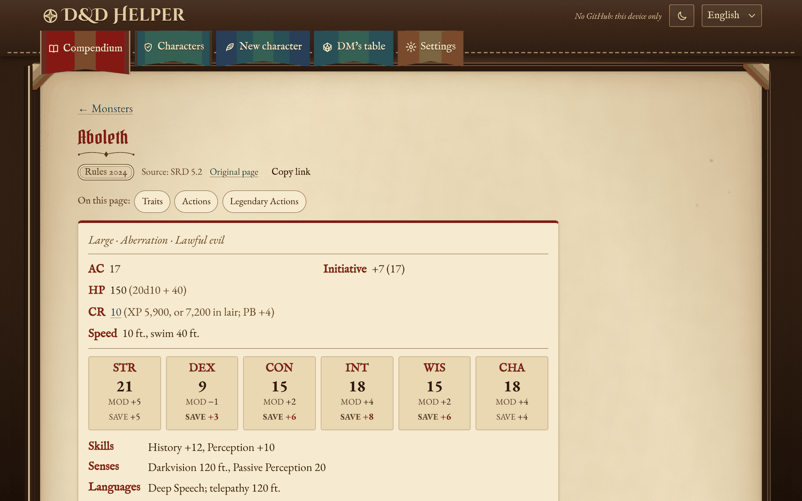
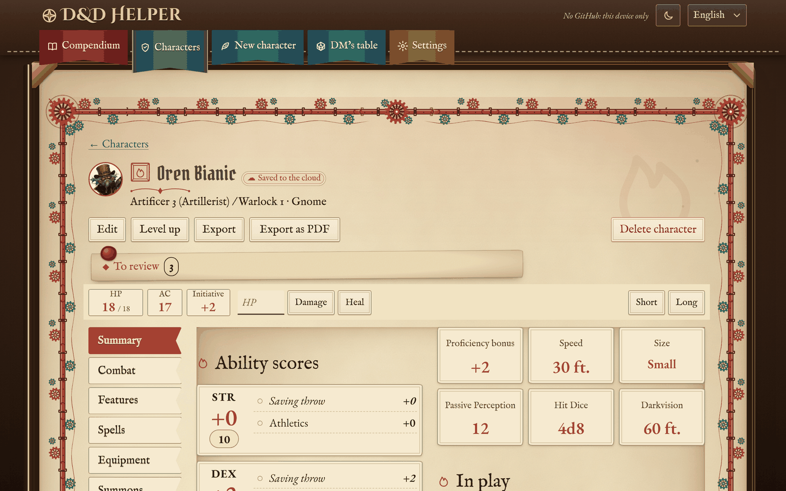
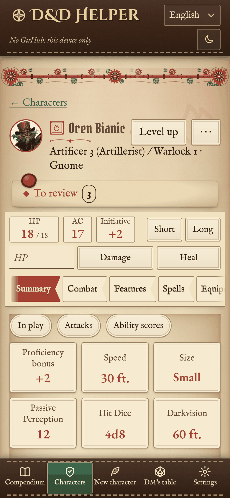
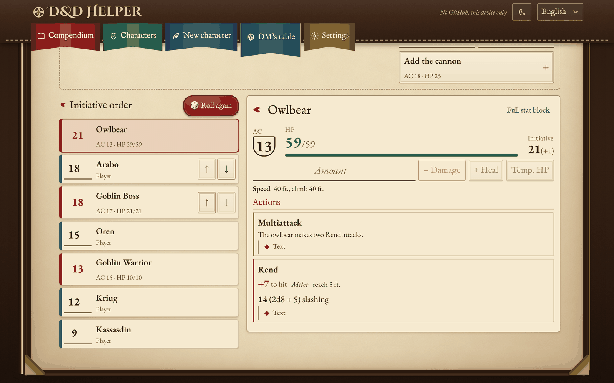
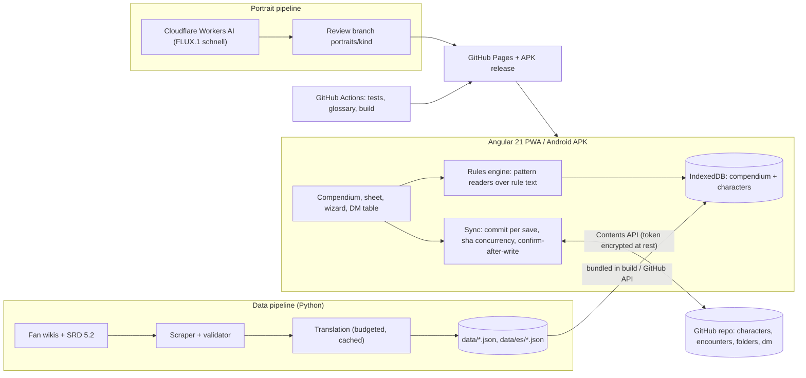

<div align="center">

# D&D Helper

**An offline-first D&D 5e companion: a rules engine that reads the real rules text, a GitHub repo used as the backend, and an AI-assisted, agent-orchestrated way of building it.**

[](https://github.com/1dardo1/DnD_helper/actions/workflows/app.yml)


[](LICENSE)

[Live demo](https://1dardo1.github.io/DnD_helper/) · [Android APK](https://github.com/1dardo1/DnD_helper/releases/tag/android-latest) · [Architecture decisions](docs/adr/README.md) · [AI engineering](docs/AI-ENGINEERING.md) · [Español](#-español)

</div>

> Unaffiliated fan tool. Not endorsed by Wizards of the Coast. See [License & credits](#license--credits).

A personal D&D 5e (2024 rules, with 2014 content adapted) companion for a Spanish-speaking player and DM:
searchable compendium, character creation and level-up, a computed character sheet, a DM table with
encounters and tracked combat, and PDF export. The UI is bilingual (es/en) with a medieval adventurer's
journal look. It runs as a PWA on GitHub Pages and as an Android APK.

The web demo needs no token to browse the compendium. The default branch is the production branch
(`claude/practical-ride-qnr51a`, not `main`); it is pinned in the Pages and APK workflows and in the app's
settings, so it is not renamed.

## Screenshots

<table align="center">
  <tr>
    <td align="center"><br><sub>Compendium (desktop)</sub></td>
    <td align="center"><br><sub>Character sheet (desktop)</sub></td>
  </tr>
  <tr>
    <td align="center"><br><sub>Character sheet (mobile)</sub></td>
    <td align="center"><br><sub>DM table (desktop)</sub></td>
  </tr>
</table>

## Why it exists (honest version)

I play D&D and wanted one app that works at the table, offline, in Spanish, with my own characters. It is
also a deliberately realistic playground for things I care about as a backend/architecture person: a
system with **no server of its own**, a rules domain that is huge and irregular, data pipelines that must
not corrupt each other, and a development workflow built around AI agents with guard rails. It is a
personal project with a single user, not a product; the engineering is the point.

## What makes it interesting, engineering-wise

- **Rules engine driven by the real rules text.** There is no hand-written table per feat or feature.
  `core/rules` (`engine.ts`, `feat-effects.ts`, `trait-effects.ts`, `trait-choices.ts`) runs *pattern
  readers* over the `description` text of `data/*.json` and computes the sheet (`computeSheet`): scores,
  AC, HP, saves, skills, spellcasting (multiclass included), resources and recharges. The character file
  stores only the player's decisions; everything else is derived. What the readers cannot understand
  surfaces as a warning on the sheet instead of a silent guess. Project rule: no mechanic without a test
  using real data.
- **Offline-first, with a Git repo as the backend.** The compendium is cached in IndexedDB (re-downloaded
  only when `data/meta.json` changes). Characters live on the device first and are pushed to the repo
  through the GitHub API: **every save is a commit**, with **optimistic concurrency via the git blob sha**
  (a rejected commit means someone changed the file). After writing, the app re-reads the repo and only
  marks a character "saved to the cloud" if the file is identical (**confirm-after-write**). Divergent
  versions go to a **conflict screen** that shows both side by side (keep one, or keep both). Discarded
  versions stay in git history.
- **Security without a server.** The GitHub token can be stored encrypted (**AES-GCM**, key from a password
  via **PBKDF2-SHA256, 600,000 iterations**, minimum 12 characters) so a new device only needs the password.
  Password-protected folders of characters are written to the repo encrypted (**AES-GCM 256**, key from the
  password with **argon2id**: 19 MiB, 2 passes, 1 lane, parameters stored per lock). Encounters are encrypted
  with a DM password (AES-GCM + PBKDF2). Only the random id and a timestamp are readable in the repo. The
  app README states the limits plainly: the encrypted token file is public with the app, so the password
  must be long.
- **Performance budgets enforced by the build.** `angular.json` fails the production build above 1 MB of
  initial bundle (warning at 600 kB) and above 20 kB per component style (warning at 12 kB). Every route is
  its own lazy chunk; English UI strings are a separate chunk; per-feature i18n dictionaries are loaded on
  demand with `I18nService.extend()`; the sync status in the toolbar is behind `@defer`. The known budget
  risks are written down in `CLAUDE.md`.
- **Data pipeline.** A Python scraper turns two fan wikis into a common JSON schema, adapts 2014 content
  to the 2024 rules, merges editions, and validates the result (`python -m dndscraper.validate`). A
  scheduled workflow (every 3 hours) continues the Spanish translation with a time budget, rate-limit
  backoff and a persisted translation cache until it reaches 100%. A glossary check (`npm run check-glossary`)
  fails CI when a new game term has no Spanish translation.
- **Generative AI pipeline** (`tools/portraits`). Portraits for species and monsters with Cloudflare Workers
  AI (FLUX.1 schnell): a provider abstraction (`Provider` with `QuotaExceeded` / `AuthError` / `ProviderError`
  semantics, plus a `fake` provider for tests), reproducible seeds, a prompt fingerprint (`prompt_hash`) in
  `generated.json` to know which images are stale, a quota-aware daily scheduled workflow that resumes where
  it stopped, and output to a review branch (never straight to production). **Status: blocked** until the
  Cloudflare secrets are created (see [`PENDIENTE.md`](PENDIENTE.md)); the code and its tests exist, but no
  portraits have been generated through it yet.
- **AI-assisted, agent-orchestrated development.** [`CLAUDE.md`](CLAUDE.md) holds the hard rules and a routing
  table that picks model and effort per subagent task; work happens in isolated git worktrees; there are
  7 project skills in [`.claude/skills/`](.claude/skills) (verify, merge-agent, deploy, data, rules,
  UI testing, portraits). A multi-agent audit ran 16 Sonnet auditors over feats, species and the 14 classes
  with their 205 subclasses against the real data and what the engine computes (table below). See
  [docs/AI-ENGINEERING.md](docs/AI-ENGINEERING.md).
- **CI/CD.** 6 GitHub Actions workflows (below). The Pages workflow runs the glossary check and the tests
  before building, so a failing version is never published and the site stays on the last good one.

### Rules assistant (RAG) - new

A rules assistant answers questions grounded in the compendium: retrieval runs in the browser over the
compendium, and the answer is produced by an LLM through a Cloudflare Worker proxy. See
[docs/ASSISTANT-EVAL.md](docs/ASSISTANT-EVAL.md) for measured retrieval quality.

### The multi-agent audit in numbers

From [`docs/auditoria/resumen.md`](docs/auditoria/resumen.md) (the audit documents are in Spanish):

| Block | complete | partial | missing | text is enough |
| --- | ---: | ---: | ---: | ---: |
| Feats (313) | 192 | 79 | 25 | 17 |
| Species (89 + variants) | 133 | 20 | 23 | 54 |
| Classes and subclasses (14 + 205) | 490 | 169 | 236 | 507 |

The gaps were grouped into 11 shared systems (choices inside class features, proficiencies granted by
features, activatable states, ...), which drives the order of the fixes.

## Architecture



## Tech stack

| Area | What |
| --- | --- |
| Frontend | Angular 21 (standalone components, signals), TypeScript 5.9, `@angular/service-worker` (PWA) |
| Mobile | Capacitor 8 (Android APK generated on every CI run) |
| Storage / sync | IndexedDB, GitHub Contents API, `localStorage` for settings |
| Crypto | Web Crypto (AES-GCM, PBKDF2-SHA256), `hash-wasm` (argon2id) |
| Other libs | `pdf-lib` (sheet PDF export, lazy), `marked` |
| Tests | Vitest (jsdom), Python `unittest` |
| Data tools | Python scraper + translator + validator (`tools/scraper`) |
| AI | Cloudflare Workers AI / FLUX.1 schnell (`tools/portraits`), RAG assistant |
| CI/CD | GitHub Actions, GitHub Pages |

## Project structure

```
app/                  Angular app (web + Android)
  src/app/core/       rules/ (engine), characters/ (sync), data/, compendium/, storage/, organize/
                      (folder locks), dm/ (encounters, combat), i18n/, creation/, play/, export/ ...
  src/app/features/   compendium, characters, creation, level-up, dm, homebrew, settings ...
data/                 compendium JSON (generated by the scraper); data/es/ = Spanish
tools/scraper/        Python extractor, translator, validator
tools/portraits/      AI portrait pipeline (+ tests)
characters/ encounters/ homebrew/ dm/ folders/   user data written by the app through the GitHub API
docs/                 audit (docs/auditoria, in Spanish), ADRs, AI engineering, assistant evaluation
.claude/skills/       project skills for the AI agents
.github/workflows/    CI/CD and scheduled jobs
```

## Build and run

Needs Node.js 22.12+ (24 recommended) and npm 11.

```bash
cd app
npm install
npm start          # http://localhost:4200, reads ../data and ../characters locally (read-only) without a token
npm test           # unit tests (Vitest)
npm run build      # production build, enforces the size budgets
npm run check-glossary
```

Data tools (offline, safe):

```bash
cd tools/scraper
pip install -r requirements.txt
python -m dndscraper.validate              # validate data/*.json
python -m dndscraper.translate --offline   # regenerate data/es from the translation cache
```

The full online extraction is meant to be launched from the "Extraer datos de las wikis" workflow, not locally.
To sync characters with your own fork you need a fine-grained GitHub token (Contents: read and write on that
repo only); details in [`app/README.md`](app/README.md) (Spanish).

## Testing and CI

- **104 spec files** in `app/src` (about 1,150 `it(...)` cases, counted with grep), mostly rules-engine tests on
  real compendium data, plus sync, crypto, folder locks, encounters and combat.
- **43 Python tests** (`def test`) for the portrait pipeline: providers, quota handling, pipeline, monsters.
- **6 workflows** in `.github/workflows/`:

| Workflow | What it does |
| --- | --- |
| `app.yml` | Glossary check, tests and production build on push and pull requests touching `app/` or `data/` |
| `pages.yml` | Glossary check, tests, build with data bundled, publishes to GitHub Pages; never publishes a failing build |
| `apk.yml` | Builds and signs the Android APK; publishes it to the `android-latest` release (prerelease) |
| `scrape.yml` | Manual extraction from the wikis, validation, commit of `data/` |
| `translate.yml` | Scheduled every 3 hours: continues the Spanish translation until complete |
| `portraits.yml` | Daily scheduled AI portrait generation to a review branch (needs Cloudflare secrets; does nothing without them) |

## Status

Working and used: compendium (including the 331 SRD 5.2 monsters), creation wizard with multiclass, level-up,
computed sheet, sync with conflict resolution, backup/import, DM table with encounters and combat, PDF export, PWA
and APK. Known gaps, stated plainly: the audit shows partial or missing mechanics mostly for 2014/UA subclasses
and choices inside class features; the APK is not signed with a stable key yet (each build must be uninstalled
before installing the next); AI portraits wait on Cloudflare secrets. Other tasks are tracked in
[`CLAUDE.md`](CLAUDE.md) and [`PENDIENTE.md`](PENDIENTE.md) (Spanish).

## License & credits

- **Code**: [MIT](LICENSE), copyright Carlos Martín Velázquez.
- **Game content in `data/`** includes material from the System Reference Document 5.2 by Wizards of the
  Coast LLC, available under the [CC-BY-4.0](https://creativecommons.org/licenses/by/4.0/legalcode) license
  (the app credits it on the compendium home and on every monster sheet).
- **Other compendium text** (classes, species, spells, feats, items beyond the SRD) comes from the fan wikis
  [dnd5e.wikidot.com](https://dnd5e.wikidot.com) and [dnd2024.wikidot.com](https://dnd2024.wikidot.com)
  (see [`tools/scraper/README.md`](tools/scraper/README.md)). That text is **not** covered by the MIT license
  and remains the property of its respective owners.
- D&D Helper is an unaffiliated fan tool.

---

<a id="-español"></a>

<div align="center">

# 🇪🇸 Español

</div>

**Un compañero de D&D 5e offline-first: un motor de reglas que lee el texto real de las reglas, un repo de GitHub como backend y una forma de desarrollo asistida por IA y orquestada con agentes.**

[Demo en vivo](https://1dardo1.github.io/DnD_helper/) · [APK de Android](https://github.com/1dardo1/DnD_helper/releases/tag/android-latest) · [Decisiones de arquitectura](docs/adr/README.md) · [Ingeniería con IA](docs/AI-ENGINEERING.md) · [English](#dd-helper)

> Herramienta de fans sin afiliación. No está respaldada por Wizards of the Coast. Ver [Licencia y créditos](#licencia-y-créditos).

Un compañero personal de D&D 5e (reglas de 2024, con contenido de 2014 adaptado) para un jugador y DM
hispanohablante: compendio con buscador, creación y subida de nivel de personajes, hoja calculada, mesa del DM con
encuentros y combate rastreado, y exportación a PDF. La interfaz es bilingüe (es/en) con estética de diario de
aventurero medieval. Funciona como PWA en GitHub Pages y como APK de Android.

La demo web no necesita token para consultar el compendio. La rama por defecto es la rama de producción
(`claude/practical-ride-qnr51a`, no `main`); está fijada en los workflows de Pages y APK y en los ajustes de la
app, por eso no se renombra.

## Capturas

Son las mismas de la sección [Screenshots](#screenshots): compendio (escritorio), hoja de personaje (escritorio
y móvil) y mesa del DM (escritorio).

## Por qué existe (versión honesta)

Juego a D&D y quería una sola app que funcione en la mesa, sin conexión, en español y con mis propios
personajes. Además es un terreno de pruebas deliberadamente realista para lo que me interesa como perfil de
backend y arquitectura: un sistema **sin servidor propio**, un dominio de reglas enorme e irregular, pipelines de
datos que no deben estropearse entre sí y un flujo de desarrollo construido alrededor de agentes de IA con
barandillas. Es un proyecto personal con un solo usuario, no un producto; lo que importa es la ingeniería.

## Qué lo hace interesante, técnicamente

- **Motor de reglas guiado por el texto real.** No hay una tabla escrita a mano por dote o rasgo. `core/rules`
  (`engine.ts`, `feat-effects.ts`, `trait-effects.ts`, `trait-choices.ts`) aplica *lectores de patrones* sobre
  la `description` de `data/*.json` y calcula la hoja (`computeSheet`): características, CA, PG, salvaciones,
  habilidades, lanzamiento de conjuros (con multiclase), recursos y recargas. El fichero del personaje solo
  guarda las decisiones del jugador; el resto se deriva. Lo que los lectores no entienden sale como aviso en la
  hoja, no como una suposición silenciosa. Regla del proyecto: ninguna mecánica sin un test con datos reales.
- **Offline-first con un repo de Git como backend.** El compendio se cachea en IndexedDB (solo se vuelve a
  descargar cuando cambia `data/meta.json`). Los personajes viven primero en el dispositivo y se suben al repo
  con la API de GitHub: **cada guardado es un commit**, con **concurrencia optimista mediante el sha del blob
  de git** (un commit rechazado significa que alguien cambió el fichero). Tras escribir, la app relee el repo y
  solo marca el personaje como «guardado en la nube» si el fichero es idéntico (**confirmación tras escritura**).
  Las versiones divergentes van a una **pantalla de conflicto** que enseña ambas lado a lado (quedarse con una o
  con las dos). La versión descartada sigue en el historial de git.
- **Seguridad sin servidor.** El token de GitHub puede guardarse cifrado (**AES-GCM**, clave derivada de una
  contraseña con **PBKDF2-SHA256, 600 000 iteraciones**, mínimo 12 caracteres) para que un dispositivo nuevo
  solo necesite la contraseña. Las carpetas protegidas con contraseña se escriben cifradas en el repo
  (**AES-GCM 256**, clave derivada con **argon2id**: 19 MiB, 2 pasadas, 1 carril, parámetros guardados por
  candado). Los encuentros se cifran con una contraseña del DM (AES-GCM + PBKDF2). En el repo solo se lee el id
  aleatorio y una marca de tiempo. El README de la app dice los límites sin rodeos: el fichero del token cifrado
  se publica con la app, así que la contraseña debe ser larga.
- **Presupuestos de rendimiento que impone la build.** `angular.json` hace fallar la build de producción por
  encima de 1 MB de bundle inicial (aviso a 600 kB) y de 20 kB por estilo de componente (aviso a 12 kB). Cada
  ruta es un chunk con carga diferida; los textos en inglés son un chunk aparte; los diccionarios por zona se
  cargan bajo demanda con `I18nService.extend()`; el estado de sincronización de la barra va en `@defer`. Los
  riesgos de presupuesto conocidos están anotados en `CLAUDE.md`.
- **Pipeline de datos.** Un scraper en Python convierte dos wikis de fans a un esquema JSON común, adapta el
  contenido de 2014 a las reglas de 2024, fusiona ediciones y valida el resultado
  (`python -m dndscraper.validate`). Un workflow programado (cada 3 horas) continúa la traducción al español con
  presupuesto de tiempo, espera ante límites de ritmo y una caché de traducciones persistente hasta llegar al
  100 %. Una comprobación de glosario (`npm run check-glossary`) hace fallar la CI si un término de juego nuevo
  no tiene traducción.
- **Pipeline de IA generativa** (`tools/portraits`). Retratos de especies y monstruos con Cloudflare Workers AI
  (FLUX.1 schnell): abstracción de proveedores (`Provider` con semántica `QuotaExceeded` / `AuthError` /
  `ProviderError`, más un proveedor `fake` para tests), semillas reproducibles, huella del prompt
  (`prompt_hash`) en `generated.json` para saber qué imágenes han quedado viejas, un workflow diario programado
  que respeta la cuota y sigue donde se quedó, y salida a una rama de revisión (nunca directo a producción).
  **Estado: bloqueado** hasta que existan los secretos de Cloudflare (ver [`PENDIENTE.md`](PENDIENTE.md)); el
  código y sus tests existen, pero todavía no se ha generado ningún retrato con él.
- **Desarrollo asistido por IA y orquestado con agentes.** [`CLAUDE.md`](CLAUDE.md) recoge las reglas duras y
  una tabla que elige modelo y esfuerzo por tarea de subagente; el trabajo se hace en worktrees de git aislados;
  hay 7 skills del proyecto en [`.claude/skills/`](.claude/skills) (verificar, fusionar agente, desplegar,
  datos, reglas, pruebas de UI, retratos). Una auditoría multiagente puso a 16 auditores Sonnet a revisar dotes,
  especies y las 14 clases con sus 205 subclases contra los datos reales y lo que calcula el motor (tabla más
  abajo). Ver [docs/AI-ENGINEERING.md](docs/AI-ENGINEERING.md).
- **CI/CD.** 6 workflows de GitHub Actions (más abajo). El de Pages ejecuta la comprobación de glosario y los
  tests antes de compilar, así que una versión que falla nunca se publica y la web se queda en la última buena.

### Asistente de reglas (RAG) - nuevo

Un asistente de reglas responde preguntas basadas en el compendio: la recuperación se hace en el navegador sobre
el compendio y la respuesta la genera un LLM a través de un proxy en un Cloudflare Worker. Ver
[docs/ASSISTANT-EVAL.md](docs/ASSISTANT-EVAL.md) para la calidad de recuperación medida.

### La auditoría multiagente en cifras

De [`docs/auditoria/resumen.md`](docs/auditoria/resumen.md) (los documentos de la auditoría están en español):

| Bloque | completo | parcial | falta | basta el texto |
| --- | ---: | ---: | ---: | ---: |
| Dotes (313) | 192 | 79 | 25 | 17 |
| Especies (89 + variantes) | 133 | 20 | 23 | 54 |
| Clases y subclases (14 + 205) | 490 | 169 | 236 | 507 |

Las carencias se agruparon en 11 sistemas comunes (elecciones dentro de rasgos de clase, competencias concedidas
por rasgos, estados activables, ...), lo que marca el orden de los arreglos.

## Arquitectura

El diagrama es el de la sección [Architecture](#architecture) de arriba.

## Stack técnico

| Área | Qué |
| --- | --- |
| Frontend | Angular 21 (componentes standalone, signals), TypeScript 5.9, `@angular/service-worker` (PWA) |
| Móvil | Capacitor 8 (APK de Android generada en cada ejecución de CI) |
| Almacenamiento / sync | IndexedDB, API Contents de GitHub, `localStorage` para ajustes |
| Criptografía | Web Crypto (AES-GCM, PBKDF2-SHA256), `hash-wasm` (argon2id) |
| Otras librerías | `pdf-lib` (exportar la hoja a PDF, carga diferida), `marked` |
| Tests | Vitest (jsdom), `unittest` de Python |
| Herramientas de datos | Scraper + traductor + validador en Python (`tools/scraper`) |
| IA | Cloudflare Workers AI / FLUX.1 schnell (`tools/portraits`), asistente RAG |
| CI/CD | GitHub Actions, GitHub Pages |

## Estructura del proyecto

```
app/                  App Angular (web + Android)
  src/app/core/       rules/ (motor), characters/ (sync), data/, compendium/, storage/, organize/
                      (candados de carpeta), dm/ (encuentros, combate), i18n/, creation/, play/, export/ ...
  src/app/features/   compendium, characters, creation, level-up, dm, homebrew, settings ...
data/                 JSON del compendio (lo genera el scraper); data/es/ = español
tools/scraper/        Extractor, traductor y validador en Python
tools/portraits/      Pipeline de retratos con IA (+ tests)
characters/ encounters/ homebrew/ dm/ folders/   datos de usuario que la app escribe con la API de GitHub
docs/                 auditoría (docs/auditoria), ADR, ingeniería con IA, evaluación del asistente
.claude/skills/       skills del proyecto para los agentes de IA
.github/workflows/    CI/CD y tareas programadas
```

## Compilar y ejecutar

Requiere Node.js 22.12 o superior (recomendado 24) y npm 11.

```bash
cd app
npm install
npm start          # http://localhost:4200, sin token lee ../data y ../characters en local (solo lectura)
npm test           # tests unitarios (Vitest)
npm run build      # build de producción, aplica los presupuestos de tamaño
npm run check-glossary
```

Herramientas de datos (sin conexión, seguras):

```bash
cd tools/scraper
pip install -r requirements.txt
python -m dndscraper.validate              # valida data/*.json
python -m dndscraper.translate --offline   # regenera data/es desde la caché de traducciones
```

La extracción online completa se lanza desde el workflow «Extraer datos de las wikis», no en local. Para
sincronizar personajes con tu propio fork necesitas un token fine-grained de GitHub (Contents: read and write
solo en ese repo); detalles en [`app/README.md`](app/README.md).

## Pruebas y CI

- **104 ficheros de spec** en `app/src` (unos 1 150 casos `it(...)`, contados con grep), sobre todo tests del
  motor de reglas con datos reales del compendio, más sincronización, criptografía, candados de carpeta,
  encuentros y combate.
- **43 tests de Python** (`def test`) del pipeline de retratos: proveedores, gestión de cuota, pipeline, monstruos.
- **6 workflows** en `.github/workflows/`: `app.yml` (glosario, tests y build en push y PR), `pages.yml`
  (glosario, tests, build con datos y publicación en Pages; nunca publica una build que falla), `apk.yml`
  (compila y firma la APK y la publica en la release `android-latest`), `scrape.yml` (extracción manual de las
  wikis con validación), `translate.yml` (programado cada 3 horas, continúa la traducción) y `portraits.yml`
  (generación diaria programada de retratos a una rama de revisión; necesita los secretos de Cloudflare y sin
  ellos no hace nada).

## Estado

Funciona y se usa: compendio (con los 331 monstruos del SRD 5.2), asistente de creación con multiclase, subida de
nivel, hoja calculada, sincronización con resolución de conflictos, copia de seguridad e importación, mesa del DM
con encuentros y combate, exportación a PDF, PWA y APK. Los huecos conocidos se dicen sin adornos: la auditoría
muestra mecánicas parciales o ausentes sobre todo en subclases de 2014/UA y en elecciones dentro de rasgos de
clase; la APK aún no se firma con una clave estable (hay que desinstalar cada build antes de instalar la
siguiente); los retratos con IA esperan los secretos de Cloudflare. El resto de tareas está en
[`CLAUDE.md`](CLAUDE.md) y [`PENDIENTE.md`](PENDIENTE.md).

## Licencia y créditos

- **Código**: [MIT](LICENSE), copyright Carlos Martín Velázquez.
- **El contenido de juego de `data/`** incluye material del System Reference Document 5.2 de Wizards of the
  Coast LLC, disponible bajo licencia [CC-BY-4.0](https://creativecommons.org/licenses/by/4.0/legalcode) (la
  app lo indica en la portada del compendio y en cada ficha de monstruo).
- **El resto del texto del compendio** (clases, especies, conjuros, dotes y objetos más allá del SRD) procede de
  las wikis de fans [dnd5e.wikidot.com](https://dnd5e.wikidot.com) y [dnd2024.wikidot.com](https://dnd2024.wikidot.com)
  (ver [`tools/scraper/README.md`](tools/scraper/README.md)). Ese texto **no** está cubierto por la licencia MIT
  y sigue siendo propiedad de sus respectivos dueños.
- D&D Helper es una herramienta de fans sin afiliación.
