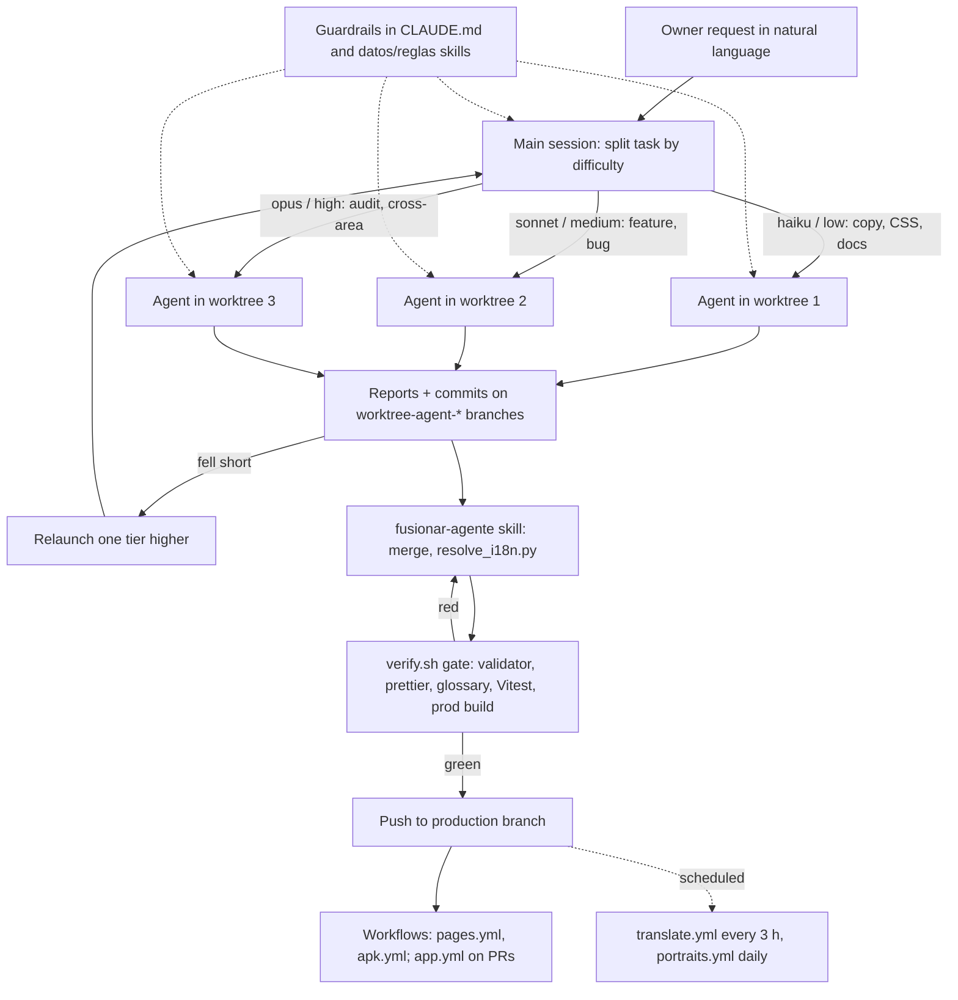

# AI engineering in D&D Helper

A personal D&D 5e companion app (Angular 21 PWA + Android APK, Python scraper, Cloudflare Workers AI
portrait pipeline) that doubles as a working example of agent orchestration, agent-based evaluation
and AI-assisted DevOps. Everything below is grounded in files of this repo; paths are cited so each
claim can be checked. Where something could not be measured or is not finished, it says so.

## Summary

1. The app is built day to day by **delegating work to coding subagents** under a written
   orchestration design: cost-aware model/effort routing, one git worktree per agent, a single
   quality gate, a merge protocol and hard guardrails (`CLAUDE.md`, `.claude/skills/`).
2. The rules engine was **evaluated by 16 parallel LLM auditors** against the real rules text
   (`docs/auditoria/`): 313 feats, 89 species and 14 classes with 205 subclasses graded
   complete / partial / missing, then partly re-verified with 216 generated test characters.
3. A **generative-image pipeline** (`tools/portraits/`) has provider abstraction, reproducible
   seeds, prompt fingerprints, a review step, quota-aware scheduling and 43 unit tests. It is
   **built but has not produced images yet**: it is blocked on Cloudflare secrets.
4. The **translation step** of the scraper uses Google's free public translate endpoint, **not an
   LLM**; its engineering value is budgets, backoff, caching and glossary enforcement.
5. A retrieval-augmented **rules assistant** is being added (section 5); nothing about it is
   claimed as done here.

---

## 1. How the app is built with AI agents

This is the development system, not a product feature. The owner asks for features in natural
language; the main Claude Code session routes the work to subagents and keeps verification and
merge to itself (`CLAUDE.md`, section "Forma de trabajar con el usuario").

### 1.1 Project skills (`.claude/skills/`)

Seven skills, each a `SKILL.md` (Spanish, with a frontmatter description that tells the agent when
to load it). Two ship helper scripts; one ships Playwright scripts.

| Skill | What it automates | Notable mechanics |
| --- | --- | --- |
| `verificar` (`.claude/skills/verificar/`) | Every check CI and the deploys require, in the same order | `verify.sh` is the **single quality gate**: scraper validator (only if `data/` or `tools/scraper/` changed), a rule that refuses data changes without bumping `translatedAt` in `data/meta.json` (otherwise cached devices would never download them), prettier, glossary check, Vitest, production build. `--fast` skips the build for iteration. The skill states it mirrors `app.yml`/`pages.yml`/`apk.yml`, which do not publish if glossary or tests fail. |
| `fusionar-agente` (`.claude/skills/fusionar-agente/`) | Merging a subagent's `worktree-agent-*` branch into the production branch | `resolve_i18n.py` resolves `es.ts`/`en.ts` merge conflicts by keeping both sides (parallel agents mostly just add keys) and **fails if duplicate keys remain**, forcing a human choice. Guidance for additive conflicts in `engine.ts` and templates; re-run the gate after merging; remove the worktree; merge the remote branch before pushing because the app itself pushes character commits to the same branch. The skill says the agent's report is a claim to check, not a fact. |
| `desplegar` (`.claude/skills/desplegar/`) | Publishing and diagnosing deploys | Table of the six workflows (`.github/workflows/`: `app`, `pages`, `apk`, `translate`, `portraits`, `scrape`), how to check a commit's runs, what to do per failure type, rollback. `scrape.yml` is marked "do not launch" without the owner's request. |
| `datos` (`.claude/skills/datos/`) | Domain guardrail for the compendium | Rule: any change to `data/*.json` needs the equivalent rule in `tools/scraper/` in the same commit, because the next extraction would erase hand edits. Maps each kind of change to the file that owns it (`names.es.yaml`, `fixes.es.yaml`, `terms.es.yaml`, `pipeline.py`...). |
| `reglas` (`.claude/skills/reglas/`) | Domain guardrail for the rules engine | Mechanics must come from the **real text** in `data/*.json`, copied into Vitest tests that use real data ("red first, then fix"); if the owner's memory of a rule differs from the text, tell them what the text says. Table of where each kind of mechanic lives (`feat-effects.ts`, `trait-effects.ts`, `trait-choices.ts`, `attacks.ts`...). |
| `probar-ui` (`.claude/skills/probar-ui/`) | Visual verification | Starts the dev server and drives Playwright: `shot.js` takes screenshots at 390x844, 820x1180 and 1280x800, light/dark, with scroll offsets; `nav-e2e.js` walks the "back" navigation end to end. It records lessons learned (dark mode and scroll reveal bugs a clean screenshot hides) and says to look at the images before claiming a change looks right. |
| `retratos` (`.claude/skills/retratos/`) | Operating the portrait pipeline | Flow: style test on four species first, then all species, then monsters; images land on a review branch, never on production. Never ask for or create the owner's credentials. See section 3. |

### 1.2 Orchestration design (`CLAUDE.md`)

| Element | Design | Where |
| --- | --- | --- |
| Roles | Main session = router, verifier, merger, reporter. Subagents = implementers/auditors with a self-contained brief, running in the background. | `CLAUDE.md` "Forma de trabajar con el usuario" |
| Routing | `model` and `effort` are chosen per task, never left at default (standing instruction from the owner). Mechanical text/CSS/docs work: `haiku`/`low`. Normal feature or bug in one area: `sonnet`/`medium`. Cross-area or judgment work (data audits against the engine, general mechanisms, merges with logic conflicts, bugs that already survived a fix): `opus`/`high`. Very hard design/debugging: `opus` or `fable` at `xhigh`. | `CLAUDE.md` table "Subagentes: modelo y esfuerzo" |
| Cost control | `max` effort only if the owner asks; `fable` "is the most expensive, not for routine work"; mixed tasks are **split** into several agents (easy part on a cheaper tier, hard part on `opus`) instead of running everything at the top tier. | same section |
| Isolation | One git worktree per agent (`isolation: "worktree"`), branch `worktree-agent-<id>`; agents commit but do not push. | `CLAUDE.md`, `fusionar-agente/SKILL.md` |
| Quality gate | `verify.sh`, run by the main session after every merge, not by an agent. | `CLAUDE.md`, `verificar/SKILL.md` |
| Merge protocol | `fusionar-agente`: merge, resolve i18n mechanically, hand-merge additive code conflicts, gate, push to the single production branch. | `fusionar-agente/SKILL.md` |
| Guardrails | Never run the full online scraper (only `validate`, `translate --offline`, offline modules); never edit `data/*.json` without the scraper rule; never invent rules, only from real data with tests; every UI string in Spanish and English plus glossary (enforced by `npm run check-glossary`); production branch name is frozen. | `CLAUDE.md` "Reglas duras" |
| Escalation | An agent that fell short is resumed or relaunched **one tier above**; the report to the owner states each agent's model, effort and why. | `CLAUDE.md` |
| Known-risk register | A list of nine standing risks (bundle budgets, stale client caches, expiring token, unsigned APK, source-wiki HTML drift, quota...) the main session re-reads. | `CLAUDE.md` "Riesgos conocidos" |

### 1.3 What I could not measure

The repository checkout I worked in is a shallow clone with a single commit (`git rev-parse
--is-shallow-repository` returned `true`; `git log` shows one commit), so I cannot count how many
agent branches were merged or how often escalation happened. The routing table is a documented
policy; this repo alone does not prove how often it was followed.

Size of the test net the gate runs (measured with `find`/`grep`): 104 `*.spec.ts` files under
`app/src` (23 in `app/src/app/core/rules/`), about 1,146 `it(`/`test(` lines (a grep count, an
approximation), plus 43 Python `def test` in `tools/portraits/tests/`.

---

## 2. Agents as evaluators of the rules engine (`docs/auditoria/`)

**Problem.** The character sheet is computed by a pure engine (`app/src/app/core/rules/engine.ts`,
`computeSheet`) that reads patterns from the real rules text rather than a hand-written table
(`docs/auditoria/arquitectura.md`). With hundreds of feats, species and subclasses, nobody can
check by hand whether the engine applies each one.

**Method** (`docs/auditoria/resumen.md`, `docs/auditoria/verificacion.md`):

1. **Dump** what the engine computes with real data into `docs/auditoria/_volcado/`.
2. **16 parallel Sonnet auditors** (feats, species, and the 14 classes with their 205 subclasses)
   compared the dump and the code against the real text in `data/*.json`, read-only
   (e.g. `docs/auditoria/clases/barbarian.md`: "Solo lectura: no se ejecutó ningún test ni build").
   Each grades items complete / partial / missing / "text is enough".
3. Findings were consolidated by common system (S1 to S10 in `resumen.md`, ordered by how many
   items each fixes) and open questions that need the owner's decision went to `docs/auditoria/dudas.md`.
4. **Phase 4 verification** (`verificacion.md`): 216 generated test characters, one per subclass,
   plus specific cases; one Sonnet agent per class compared the computed sheet to the text, and
   failures were fixed by Opus in the engine with tests on real data. `verificacion.md` lists
   what was fixed in three batches and what remains pending.

**Results table** (copied from `docs/auditoria/resumen.md`):

| Block | Complete | Partial | Missing | Text is enough |
| --- | ---: | ---: | ---: | ---: |
| Feats (313) | 192 | 79 | 25 | 17 |
| Species (89 + variants) | 133 | 20 | 23 | 54 |
| Classes and subclasses (14 + 205) | 490 | 169 | 236 | 507 |

Per-edition detail in `docs/auditoria/dotes.md`: 2024 feats 154 complete of 197 with 1 missing;
2014 feats 38 complete of 116 with 24 missing. The summary's own reading is that 2024 content is
fairly complete and the gaps are mostly 2014/UA subclasses, choices inside class features and
state-dependent effects.

**How findings fed back.** The gap list became the engine backlog: `verificacion.md` records fixes
such as option-specific damage only when that option is chosen, new pickers (cantrips by school,
resistances, tool and skill choices), counters with correct rest recharge, and "Pendiente" items
still open (for example the Primordial table missing from the scraped data). `CLAUDE.md` still
cites the audit ("83 y 135 según la última auditoría") for traits with untreated numbers.

**Limits, stated honestly.**

- **Auditors are LLMs and can be wrong.** Nothing in the repo measures auditor precision. The
  counts are claims by agents, not verified facts. Phase 4 is partial protection: a second pass
  with different inputs (real generated characters) and fixes validated by tests.
- **Ground truth is the text, not the rules as intended.** If the scraped text is wrong or
  ambiguous, auditor and engine can agree and both be wrong; `dudas.md` exists for that case.
- **The dump is not in the repo**: `docs/auditoria/_volcado/` is in `.gitignore`, and I found no
  generator script for it (a grep for "volcado" in `app/` and `tools/` found nothing). The
  reports cite it, but the audit cannot be reproduced from a fresh checkout.
- **Status is a snapshot.** The counts predate the fixes in `verificacion.md`.

**Next step.** Turn each confirmed finding into a Vitest regression test on real data (the `reglas`
skill already requires this for new mechanics), and re-run a diff of the dump after changes so
the table becomes a number tracked over time instead of a one-off report. A small hand-checked
sample of auditor verdicts would give an actual error rate.

---

## 3. Generative AI pipeline in production tooling (`tools/portraits/`)

Generates one portrait per species (89 prompt entries in `species.yaml`) and per monster (331 in
`monsters.yaml`; both counts measured by loading the YAML) with Cloudflare Workers AI (FLUX.1
schnell, free tier). Design points:

- **Provider abstraction** (`providers.py`): a `Provider` base class with
  `generate(prompt, seed, size, negative, label) -> bytes`; `CloudflareProvider`, a `FakeProvider`
  that draws placeholders for offline runs, and a `PROVIDERS` registry. Typed errors
  (`ProviderError`, `QuotaExceeded`, `AuthError`). The README documents how to add another
  provider (Gemini, ComfyUI...).
- **Reproducibility**: each entry has a `seed` (default derived from a hash of the id,
  `catalog.py` `_seed_for`). The Cloudflare schema does not list `seed`; the provider sends it,
  and if the API answers 400 it retries without it and records `"seed_applied": false`, so the
  record never overstates reproducibility (`providers.py`, `tools/portraits/README.md`).
- **Prompt fingerprints** (`catalog.py` `prompt_hash`, `record.py`): `generated.json` stores, per
  image, a SHA-256 prefix of prompt + negative prompt, seed, provider, model and date.
  `Record.changed()` compares them, so `--changed` regenerates only images whose prompt or seed
  changed.
- **Review step** (`review.py`): a self-contained `review.html` contact sheet; ticking cards builds
  the `--only` list to redo. Published as a workflow artifact.
- **Quota awareness** (`portraits.yml`, README "Cuota gratuita"): the free tier is 10,000 neurons
  per day, about 170 images by the README's arithmetic, so the 331 monsters take two days. On
  quota exhaustion the tool stops, keeps what it did and reports what is left. A daily schedule
  (cron `23 4 * * *`) continues unattended, does nothing when secrets are missing or nothing is
  pending, and a `concurrency` group serializes runs.
- **Safe delivery**: images go to a review branch `portraits/<kind>` that later runs continue
  (merging the current branch in first), never straight to production.
- **Error policy**: 401/403 stop everything; daily-quota 429 stops and saves; capacity 429, 408,
  5xx retry with growing waits; other errors fail one image (three in a row stop). Credentials are
  scrubbed from logs (`CloudflareProvider._clean`).
- **Post-processing** (`imaging.py`): crop to 3:4 (sides of wide images, bottom of tall ones to keep
  heads), resize to 480 px wide, WebP at descending quality until at most 80 KB.
- **Tests** (`tools/portraits/tests/`): 43 test functions in `test_providers.py`,
  `test_pipeline.py`, `test_monsters.py` (counted with grep), run in the workflow before generating
  (`python -m unittest discover -s portraits/tests -t .`).

**Real status: blocked.** `tools/portraits/generated.json` currently contains `{}` and
`app/public/species/` holds only `README.md` and `index.json`, so no image has been generated.
`CLAUDE.md` and `PENDIENTE.md` section 2 say it waits for the owner to create
`CLOUDFLARE_ACCOUNT_ID` and `CLOUDFLARE_API_TOKEN`. Until then the scheduled workflow exits in
seconds with a notice. The pipeline has been exercised only through its tests and the fake provider;
I did not run it, and no output quality claim is made.

---

## 4. LLM-adjacent data pipeline: the translation step

`tools/scraper/dndscraper/translate.py` builds `data/es/*.json` from `data/*.json`. **What it is:**
machine translation through Google's free public endpoint
(`https://translate.googleapis.com/translate_a/single`, `client=gtx`), as its docstring says
("Uses Google's free public translate endpoint (no account)"). It is not an LLM and I make no claim
that it is. What is engineered around it:

- **Field allowlist** (`PATHS`, `OWN_PATHS`): only human-readable text is translated; ids, enums and
  every field the rules engine uses stay in English, so the engine never depends on translated text.
- **Glossary enforcement**: game terms from `tools/scraper/terms.es.yaml` (plus tool names from the
  app glossary `app/src/app/core/i18n/glossary.es.json`) are swapped for marker tokens before
  sending and restored after, so the translator cannot rename a protected term. Whole-word fixes
  from `tools/scraper/fixes.es.yaml` are applied afterward; owner-chosen names live in
  `tools/scraper/names.es.yaml`. The app side enforces the same idea: `npm run check-glossary`
  (`app/scripts/check-glossary.mjs`) fails the run if a closed-domain game term in the data has no
  Spanish entry.
- **Cache keyed by content**: `tools/scraper/translations.es.json` maps a SHA-1 of the text sent to
  its translation, so a new extraction only translates what changed; `--offline` uses the cache only.
- **Budget and backoff**: `--budget MINUTES` (default 60) bounds total waiting; on non-200 or network
  errors the wait starts at 30 s and doubles up to 600 s; past the budget it raises `Throttled`.
  The cache is saved as it goes, so a run can simply be relaunched. Requests are chunked to at most
  4,500 characters and spaced by a 1 s delay.
- **Scheduled continuation** (`.github/workflows/translate.yml`): every 3 hours, skips when
  `data/meta.json` says translation is complete.

State in the data: `data/meta.json` reports `translation.es` with 20,677 texts, 0 untranslated,
`complete: true`.

Limit: this is raw machine translation of rules text. Quality is controlled by glossary and fixes,
not measured; no evaluation of translation accuracy exists in the repo.

---

## 5. New: Rules assistant (RAG)

A retrieval-augmented assistant is being added: retrieval runs in the browser over the cached
compendium, the answer is generated by an LLM behind a Cloudflare Worker proxy, and retrieval
quality is measured with a fixed question set. Details: `docs/adr/0009-rules-assistant-rag.md`
(design decision) and `docs/ASSISTANT-EVAL.md` (evaluation). Those documents are being written in
parallel; this page makes no claim about their results.

---

## 6. What I would do next

1. **Turn the audit into regression tests and a tracked metric.** Commit the dump generator (the
   dump is git-ignored today), add a Vitest test per confirmed finding, and re-run the audit after
   engine changes so complete/partial/missing becomes a trend.
2. **Measure the auditors.** Hand-check a random sample of verdicts per block to estimate
   false-positive and false-negative rates, so the counts carry error bars.
3. **Make orchestration observable.** Record per-agent model, effort, escalation and gate failures
   in a small log (the main session already reports them to the owner), so the routing table can be
   tuned with data instead of intuition.
4. **Run the portrait pipeline once and add an automated check.** After the secrets exist, run the
   four-species style test, then add a cheap automated check (size, aspect, near-duplicate hashes)
   next to the human contact sheet.
5. **Evaluate translation quality.** Back-translate or sample-review a few hundred texts against the
   glossary to find systematic errors that belong in `fixes.es.yaml`.

---

## Resumen en español

- **Desarrollo con agentes**: la app se construye delegando en subagentes con un diseño de
  orquestación escrito (`CLAUDE.md`, `.claude/skills/`): tabla de modelo y esfuerzo según la
  dificultad (haiku, sonnet, opus, fable), tareas mixtas partidas en varios agentes, un worktree de
  git por agente, una única puerta de calidad (`verify.sh`), protocolo de fusión
  (`fusionar-agente`, `resolve_i18n.py`), reglas duras como barandillas y escalado un nivel
  si el agente se queda corto. La verificación y la fusión las hace la sesión principal.
- **Evaluación multiagente**: 16 auditores Sonnet compararon el motor de reglas con el texto real
  (`docs/auditoria/`): dotes 192 completas, 79 parciales, 25 faltan; especies 133/20/23; clases y
  subclases 490/169/236. Luego se verificó con 216 personajes de prueba y se corrigió en el motor con
  tests. Límites: los auditores son LLM y pueden fallar (no hay tasa de error medida), la verdad de
  referencia es el texto de los datos, y el volcado (`_volcado/`) no está en el repositorio.
  Siguiente paso: convertir los hallazgos en tests de regresión.
- **Retratos con IA** (`tools/portraits/`): abstracción de proveedor, semillas reproducibles,
  huellas de prompt en `generated.json`, hoja de contactos de revisión, ejecución diaria que respeta
  la cuota, post-procesado WebP y 43 tests. Estado real: **bloqueado**, aún no se ha generado
  ninguna imagen porque faltan los secretos de Cloudflare (`PENDIENTE.md`).
- **Traducción**: usa el endpoint público gratuito de Google Translate, **no un LLM**; lo
  relevante es el presupuesto de espera, el retroceso exponencial, la caché y la protección del
  glosario.
- **Asistente de reglas (RAG)**: en desarrollo; ver `docs/adr/0009-rules-assistant-rag.md` y
  `docs/ASSISTANT-EVAL.md`.
- **Siguientes pasos**: tests de regresión desde la auditoría, medir a los auditores, registrar la
  orquestación, probar el pipeline de imágenes y evaluar la traducción.
